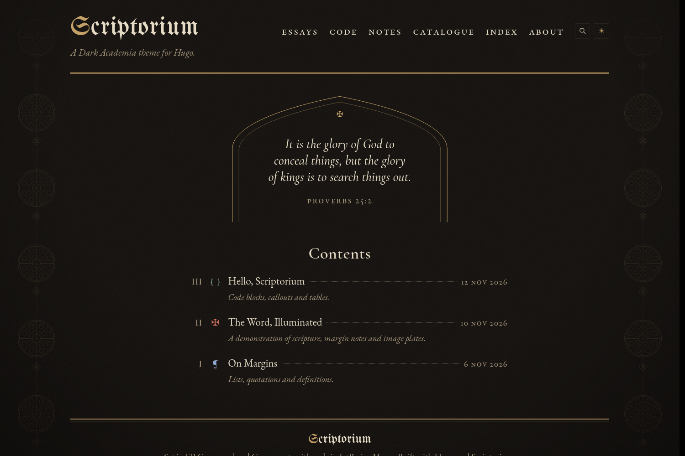

# Scriptorium

A Dark Academia theme for [Hugo](https://gohugo.io): candlelit dark mode, parchment light mode,
a blackletter wordmark, drop caps, margin notes, and scripture and code set with equal care.



**See it in use:** [Lux in Tenebris](https://lux.prinke.dev)

## Features

- **Two themes.** *Nocturne* (dark, the default) and *Vellum* (light). Follows the reader's
  system setting, with a toggle that remembers their choice and never flashes on load.
- **Manuscript typography.** A gold drop cap and a red small-caps first line on every post,
  Roman-numeral post numbers, ❦ section breaks and a ⁂ to finish.
- **Sections with their own character.** Each post section gets a marker, an accent color
  and its own line drawing in the side margins.
- **Margin notes** beside the text on wide screens, inline on phones, alongside ordinary footnotes.
- **Scripture and ancient languages.** A scripture block with verse numbers, Greek and Hebrew
  shortcodes, and optional Blue Letter Bible verse pop-ups.
- **Code.** Syntax colors built from the palette, filename headers, line numbers,
  highlighted lines and a copy button.
- **Callouts** labelled *Nota Bene*, *Caveat* and *Ergo*, written as GitHub-style alerts.
- **Images** become numbered, captioned plates, resized to WebP automatically.
- **Search** that runs in the browser with no outside service, plus an A–Z tag index and
  a year-by-year catalogue.
- **Comments** with [Giscus](https://giscus.app), styled to match.
- **Private and fast.** Self-hosted fonts, no tracking and no frameworks. Every page reads
  fine without JavaScript.
- **Easy to customize.** Every label can be changed or translated, colors can be overridden
  in one file, and there are slots for your own markup.

## Install

Requires Hugo **0.158.0** or newer. The standard edition is enough.

```sh
cd your-site
git submodule add https://github.com/prinke/scriptorium.git themes/scriptorium
```

Then in your site's `hugo.toml`:

```toml
theme = 'scriptorium'
```

To try the example site first:

```sh
git clone https://github.com/prinke/scriptorium.git
cd scriptorium/exampleSite
hugo server --themesDir ../..
```

### Required settings

Hugo doesn't read `[markup]` from a theme, so copy this into your `hugo.toml`:

```toml
[markup]
  [markup.goldmark.renderer]
    unsafe = true                               # margin notes and <cite> need inline HTML
  [markup.goldmark.parser]
    wrapStandAloneImageWithinParagraph = false  # lets an image on its own line become a plate
    [markup.goldmark.parser.attribute]
      block = true
  [markup.highlight]
    noClasses = false                           # code is colored by the theme's CSS
  [markup.tableOfContents]
    startLevel = 2
    endLevel = 3
```

### Pages to create

| File | Front matter | Gives you |
|---|---|---|
| `content/search.md` | `layout = 'search'` and `outputs = ['html', 'SearchIndex']` | The search page and its index. The header gets a search button once this page exists |
| `content/catalogue.md` | `layout = 'catalogue'` | Every post, grouped by year |
| `content/tags/_index.md` | `title = 'Index'` | The tag index, grouped by letter |

The [example site](exampleSite/content) has all three.

## Configuration

Everything goes under `[params]` in your `hugo.toml`.

```toml
[params]
  tagline = 'A line under the title on the home page.'
  description = 'Used for search engines and link previews.'
  author = 'Your Name'
  colophon = 'A short line for the footer. *Markdown* works.'

  wordmarkFont = 'blackletter'   # or 'display' for a plainer title
  wordmarkLight = ''             # a word or letter of the title to set in gold

  # Which sections hold posts. Their pages are numbered and listed on the home page.
  postSections = ['essays', 'code']

  [params.topics.essays]
    label = 'Essays'
    glyph = '✠'               # marker shown beside each post
    accent = 'rubric'         # rubric, verdigris, lapis, gold, oxblood or parchment
    art = 'tracery'           # tracery, rose, circuit, vine or none
  [params.topics.code]
    label = 'Code'
    glyph = '{ }'
    monoglyph = true          # draw the marker in the code font
    accent = 'verdigris'
    art = 'circuit'

  marginArt = true            # line art in the side margins on screens 1440px and wider
  homeArt = 'rose'            # margin art on the home page
  defaultArt = 'tracery'      # margin art on every other page
```

Use the six accent names as they are: links, markers and headings in a section all take
their color from that accent. `gold` is the weakest of them in light mode, so it's best kept
for sections that don't have many links.

### Comments (Giscus)

```toml
[params.giscus]
  repo = 'you/your-repo'
  repoId = 'R_…'
  category = 'Comments'
  categoryId = 'DIC_…'
  mapping = 'pathname'
  reactions = true      # false hides the emoji bar above the thread
```

Get the values from [giscus.app](https://giscus.app). Comments appear on posts once `repo`,
`repoId` and `categoryId` are set. An **Announcement**-type category is best, so that only
Giscus can start threads.

The comment frame is styled to match the theme: same fonts, colors and small caps, in both
modes, following the reader's toggle. Giscus loads that stylesheet and the fonts from your
site, so your server must allow cross-origin requests for `/giscus/*` and `/fonts/*`:

- **`hugo server`**: add this to your `hugo.toml` (Hugo doesn't read `[server]` from a theme):

  ```toml
  [server]
    [[server.headers]]
      for = '/giscus/**'
      [server.headers.values]
        Access-Control-Allow-Origin = '*'
    [[server.headers]]
      for = '/fonts/**'
      [server.headers.values]
        Access-Control-Allow-Origin = '*'
  ```

  Browsers also stop a public site like giscus.app from loading files from `localhost`
  unless you allow *local network access* for your dev site. Chrome, Brave and Edge show a
  prompt, or you can allow it under the site settings for `http://localhost:1313`. Until
  then the frame uses Giscus's plain default look locally. The live site isn't affected.
- **GitHub Pages**: nothing to do; it already sends the header.
- **Netlify or Cloudflare Pages**: create `static/_headers` in your site:

  ```
  /giscus/*
    Access-Control-Allow-Origin: *
  /fonts/*
    Access-Control-Allow-Origin: *
  ```

- **Anywhere else**: set `Access-Control-Allow-Origin: *` on those two paths.

Without the header, Giscus falls back to its default look. To use a different Giscus theme,
set `themeDark` and `themeLight` under `[params.giscus]` to a theme name (`noborder_dark`)
or a stylesheet URL. `term` is also available for the `specific` and `number` mappings.

### Blue Letter Bible verse pop-ups

```toml
[params.scriptTagger]
  enable = true
  translation = 'ESV'   # any Blue Letter Bible abbreviation
  hyperLinks = 'hover'  # 'hover' keeps your own links; 'all' points them at BLB
  style = 'par'         # 'par' or 'line'
```

It only runs on posts, and only links references in the post body. The script loads from
blueletterbible.org.

### Epigraphs

The home page shows a quotation in a pointed arch, rotating daily through
`data/epigraphs.yaml`. To use your own, create that file in your site:

```yaml
- text: "Faith seeking understanding."
  source: "Anselm of Canterbury, *Proslogion*"
```

## Writing

New posts start from the theme's template: `hugo new content essays/my-post.md`.

### Front matter

```toml
title = 'My Post'
date = '2026-11-13'
dek = 'An italic subtitle, shown under the title and in lists.'
tags = ['reading']
toc = true            # a contents box at the top
numbered = true       # Roman numerals on h2 headings (I., II., III.)
epigraph = { text = 'The quotation.', source = 'Who said it' }
# dropcap = false
# comments = false
# scripttagger = false
# number = 12         # override the automatic post number
```

### Syntax

| Write | You get |
|---|---|
| `Note text.` | A margin note |
| `[1] In the beginning…` | A scripture block. `[1]` becomes a verse number; add `link="…"` to link the reference |
| `λόγος` / `דָּבָר` | Text marked as Greek, or as right-to-left Hebrew |
| `> [!NB]` / `> [!CAVEAT]` / `> [!ERGO]` | Callouts. NOTE, WARNING, TIP and the other GitHub names work too; text after the marker replaces the label |
| ` ```rust {title="src/main.rs" linenos=true hl_lines=[2]} ` | A code block with a filename, line numbers and a highlighted line |
| `` on its own line | A numbered, captioned plate |
| `---` | A ❦ section break |

## Customizing

### Colors and styles

Create `assets/css/custom.css` in your site. It loads after the theme, so anything there wins:

```css
:root {
  --rubric: #B5523B;   /* dark mode */
}
:root[data-theme="light"] {
  --rubric: #7A2A20;   /* light mode, when chosen with the toggle */
}
@media (prefers-color-scheme: light) {
  :root:not([data-theme="dark"]) { --rubric: #7A2A20; }  /* light mode from the system */
}
```

The tokens are `--ink-0`, `--ink-1`, `--ink-2` (backgrounds and rules), `--parchment` and
`--parchment-dim` (text), `--gold`, `--rubric`, `--verdigris`, `--lapis`, `--oxblood`,
`--art-opacity`, and the font stacks `--f-mark`, `--f-display`, `--f-body` and `--f-mono`.
See `assets/css/tokens.css` for all of them.

### Labels and translation

Every word the theme prints, from "Contents" to *Nota Bene*, lives in [`i18n/en.toml`](i18n/en.toml).
To change one, create `i18n/en.toml` in your site with only the keys you want to override:

```toml
furtherReading = "Related posts"
comments = "Comments"
previousPost = "← Older"
nextPost = "Newer →"
```

For another language, copy the whole file to `i18n/<language>.toml` and translate it.

### Your own markup

Three empty partials are there to be replaced. Create any of them in your site's
`layouts/_partials/hooks/` folder:

| File | Inserted |
|---|---|
| `head-end.html` | At the end of `<head>`: analytics, verification tags, extra styles |
| `body-end.html` | At the end of `<body>`: scripts |
| `footer-end.html` | At the end of the footer: extra links |

Any other template can be overridden the usual Hugo way, by putting a file with the same
path in your site's `layouts/`.

## Design notes

[`STYLEGUIDE.md`](STYLEGUIDE.md) explains the design: the palette and its contrast ratios,
the type scale, the ornaments and what each one is for.

## License

Scriptorium is free software under the [GNU General Public License v3.0](LICENSE).

The bundled fonts (EB Garamond, Cormorant Garamond, UnifrakturMaguntia, JetBrains Mono and
Frank Ruhl Libre) are under the SIL Open Font License; see
[`static/fonts/OFL.txt`](static/fonts/OFL.txt). The Book of Kells image in the example site
is in the public domain.
