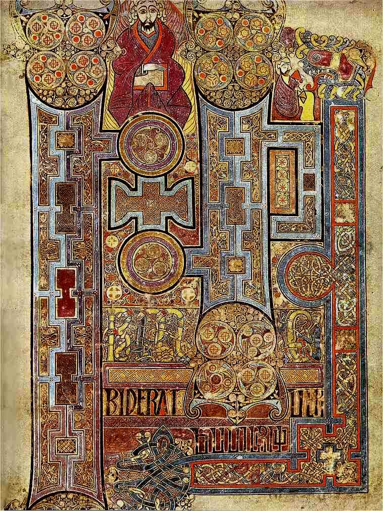

+++
title = 'The Word, Illuminated'
date = '2026-11-10T09:00:00-05:00'
dek = 'A demonstration of scripture, margin notes and image plates.'
tags = ['manuscripts', 'scripture', 'demo']
epigraph = { text = 'The light shines in the darkness, and the darkness has not overcome it.', source = 'John 1:5' }
+++

When the monks of Iona reached the first verse of John’s Gospel, they stopped writing and started drawing. The page they made is one of the most elaborate in the Book of Kells, and almost none of it is text.

The words are the Latin *In principio erat verbum*. The scribe gives the first two letters almost the whole page.Margin notes sit beside the text on wide screens and inline on phones. They are lettered, so they never clash with numbered footnotes.

## Scripture


[14] And the Word became flesh and dwelt among us, and we have seen his glory, glory as of the only Son from the Father, full of grace and truth.


The Greek for “dwelt” is ἐσκήνωσεν, “pitched his tent,” recalling the מִשְׁכָּן (*mishkan*) of Exodus 40:34.[^1]

> [!NB]
> With `scriptTagger` enabled, plain references in a post body, like Psalm 19:1, get a Blue Letter Bible pop-up.

---

The fleuron above is what a Markdown `---` becomes.

[^1]: Footnotes are numbered and collected at the end.
